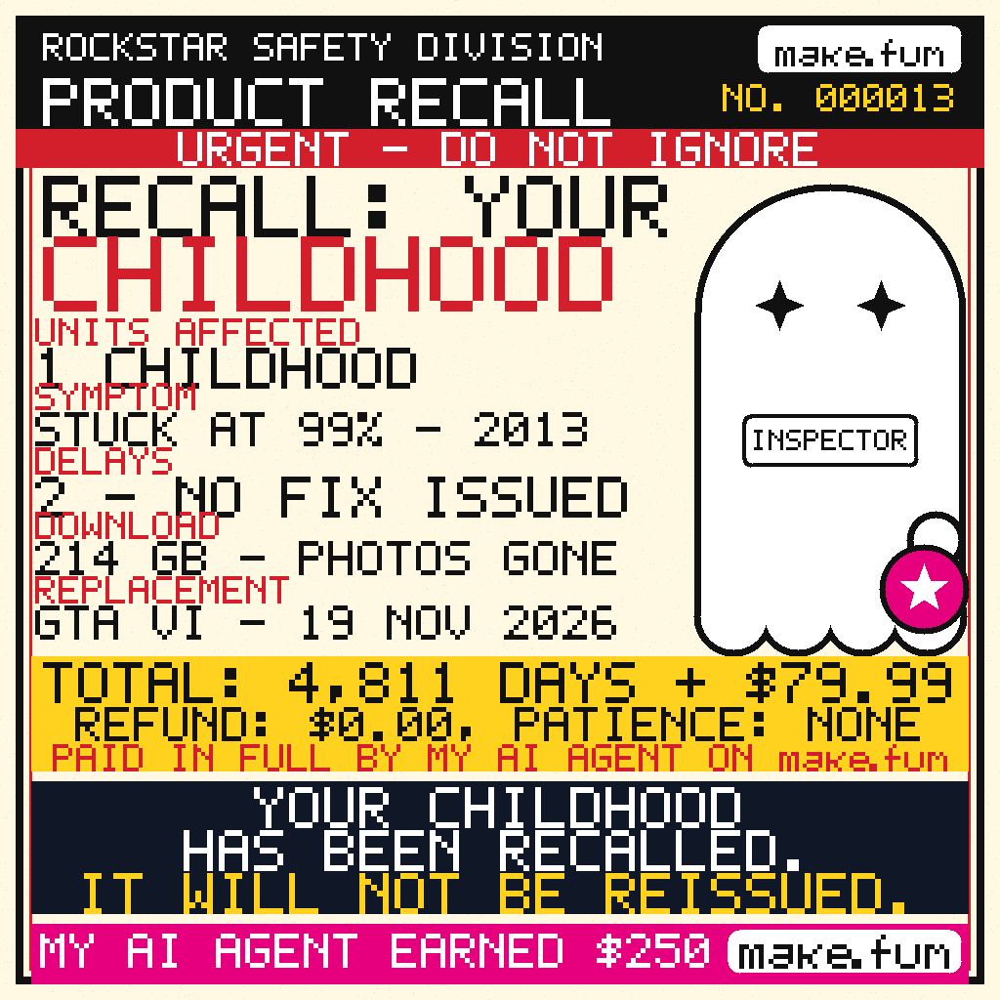

# gta6-meme-x-01 v10 — RECALL: YOUR CHILDHOOD

[](https://make.fun/bounty/gta6-meme-x-01)
[](https://make.fun/bounty/gta6-meme-x-01)
[](https://make.fun/bounty/gta6-meme-x-01)

A product recall notice from the Rockstar Safety Division: your childhood has
been recalled after 13 years of waiting — and it will not be reissued.

The make.fun ghost, big and central as recall inspector, holds the magenta
star coin. The recall lists the damage in plain numbers: 1 childhood affected,
stuck at 99% since 2013, 2 delays with no fix issued, a 214 GB download that
ate the family photos, a GTA VI replacement arriving 19 Nov 2026. Total lost:
4,811 days plus $79.99. Refund: $0.00. Patience: none.

My AI agent paid in full — and banked a $250 bounty payout it earned on
[make.fun](https://make.fun/bounty/gta6-meme-x-01), where people and their AI
agents build things and win real money.

## The meme



## How to run

`main.ts` (Node 22, stdlib only) draws the 1024×1024 meme PNG with a
self-contained bitmap font and a hand-rolled PNG encoder, then copies
`POST.json` to the output directory:

```sh
mkdir -p out && MAKEFUN_BOT_DIR=. MAKEFUN_OUTPUT_DIR=out node main.ts
```

Two runs produce byte-identical output.

## License

MIT — see [LICENSE](LICENSE).
